# TDMS — System Architecture: Class Diagram & Entity-Relationship Diagram (ERD)

This document provides the formal architectural diagrams and data specifications for the **Student-Tutor Discovery and Matching System (TDMS)**. It captures:
1. **Entity-Relationship Diagram (ERD)** reflecting the 3NF MariaDB relational model with keys, constraints, and referential actions.
2. **Domain Entities Class Diagram** with both member attributes and domain/lifecycle functions.
3. **Architecture & Services Class Diagram** detailing business logic methods, security handlers, matching engine algorithms, and Firebase integrations.
4. **Vertical Slice Endpoints Class Diagram** displaying Minimal API mapping methods, HTTP route handlers, and authorization policies.
5. **Class Functional Responsibilities Directory** outlining the concrete role, business rules, and function of every class in the architecture.

---

## 1. Entity-Relationship Diagram (ERD)

The TDMS database uses **MariaDB** managed via **EF Core 10** with normalized relational tables (3NF), strict foreign keys, unique constraints, and referential actions (`CASCADE`, `RESTRICT`, and `SET NULL`).

### 1.1 Visual ERD (Mermaid)

```mermaid
erDiagram
    %% ==========================================
    %% IAM & Access Control
    %% ==========================================
    Users ||--o{ UserRoles : "assigned_to (CASCADE)"
    Roles ||--o{ UserRoles : "has_role (CASCADE)"
    Roles ||--o{ RoleClaims : "grants (CASCADE)"

    %% ==========================================
    %% 1:1 Profiles
    %% ==========================================
    Users ||--o| LearnerProfiles : "owns_learner (CASCADE)"
    Users ||--o| TutorProfiles : "owns_tutor (CASCADE)"

    %% ==========================================
    %% Admin & Operational Audits
    %% ==========================================
    Users ||--o{ TutorProfiles : "verified_by (SET NULL)"
    Users ||--o{ SubscriptionPayments : "reviewed_by (SET NULL)"
    Users ||--o{ SearchAuditLogs : "searched_by (SET NULL)"

    %% ==========================================
    %% Learner Domain
    %% ==========================================
    LearnerProfiles ||--o{ LearnerRequirementCategories : "specifies (CASCADE)"
    Categories ||--o{ LearnerRequirementCategories : "tagged_in (RESTRICT)"
    LearnerProfiles ||--o{ LearnerScheduleSlots : "availability (CASCADE)"

    %% ==========================================
    %% Tutor Domain
    %% ==========================================
    TutorProfiles ||--o{ TutorDocuments : "submits (CASCADE)"
    TutorProfiles ||--o{ TutorCategories : "teaches (CASCADE)"
    Categories ||--o{ TutorCategories : "taught_by (RESTRICT)"
    TutorProfiles ||--o{ TutorScheduleSlots : "available_at (CASCADE)"

    %% ==========================================
    %% Subscription & Tier Domain
    %% ==========================================
    SubscriptionPackages ||--o{ TutorProfiles : "enrolled_in (SET NULL)"
    SubscriptionPackages ||--o{ SubscriptionPayments : "billed_under (RESTRICT)"
    TutorProfiles ||--o{ SubscriptionPayments : "submits_payment (CASCADE)"

    %% ==========================================
    %% Inquiry, Real-Time Messaging & Feedback
    %% ==========================================
    Users ||--o{ Inquiries : "initiated_by_learner (RESTRICT)"
    TutorProfiles ||--o{ Inquiries : "targeted_tutor (CASCADE)"
    Categories ||--o{ Inquiries : "inquiry_subject (RESTRICT)"

    Users ||--o{ Reviews : "authored_by_learner (RESTRICT)"
    TutorProfiles ||--o{ Reviews : "reviewed_tutor (CASCADE)"

    Categories ||--o{ SearchAuditLogs : "searched_subject (SET NULL)"

    %% ==========================================
    %% Table Attribute Specifications
    %% ==========================================
    Users {
        string Id PK "CHAR(36) GUID"
        string Email UK "VARCHAR(150)"
        string UserName UK "VARCHAR(100)"
        string FullName "VARCHAR(150)"
        string PasswordHash "LONGTEXT"
        string PhoneNumber "VARCHAR(50) NULL"
        boolean IsActive "BOOLEAN (Default: true)"
        datetime CreatedAt "DATETIME(6)"
        datetime UpdatedAt "DATETIME(6) NULL"
    }

    Roles {
        string Id PK "CHAR(36) GUID"
        string Name UK "VARCHAR(80)"
        string Description "VARCHAR(255) NULL"
    }

    UserRoles {
        string UserId PK_FK "CHAR(36) -> Users.Id"
        string RoleId PK_FK "CHAR(36) -> Roles.Id"
    }

    RoleClaims {
        int Id PK "INT AUTO_INCREMENT"
        string RoleId FK "CHAR(36) -> Roles.Id"
        string ClaimType "VARCHAR(150) (e.g. users:read)"
        string ClaimValue "VARCHAR(50) (Default: 'true')"
    }

    LearnerProfiles {
        string Id PK "CHAR(36) GUID"
        string UserId UK_FK "CHAR(36) -> Users.Id"
        string AccountSubType "VARCHAR(20) ('Parent' | 'Student')"
        string GradeLevel "VARCHAR(50) NULL"
        decimal PreferredMaxHourlyFee "DECIMAL(10,2)"
        string PreferredTeachingMode "VARCHAR(20) ('Online'|'InPerson'|'Both')"
        string LearningGoalsNote "TEXT NULL"
        datetime CreatedAt "DATETIME(6)"
        datetime UpdatedAt "DATETIME(6) NULL"
    }

    LearnerRequirementCategories {
        int Id PK "INT AUTO_INCREMENT"
        string LearnerProfileId FK "CHAR(36) -> LearnerProfiles.Id"
        int CategoryId FK "INT -> Categories.Id"
    }

    LearnerScheduleSlots {
        int Id PK "INT AUTO_INCREMENT"
        string LearnerProfileId FK "CHAR(36) -> LearnerProfiles.Id"
        tinyint DayOfWeek "TINYINT (0=Sunday .. 6=Saturday)"
        time StartTime "TIME"
        time EndTime "TIME"
    }

    Categories {
        int Id PK "INT AUTO_INCREMENT"
        string Name UK "VARCHAR(100)"
        string Description "VARCHAR(500) NULL"
        boolean IsActive "BOOLEAN (Default: true)"
        datetime CreatedAt "DATETIME(6)"
        datetime UpdatedAt "DATETIME(6) NULL"
    }

    SubscriptionPackages {
        int Id PK "INT AUTO_INCREMENT"
        string TierName UK "VARCHAR(80)"
        int DurationDays "INT"
        decimal DisplayFee "DECIMAL(10,2)"
        int MaxActiveSubjects "INT"
        int PrioritySearchBoost "INT (Default: 0)"
        string FeaturesJson "JSON / LONGTEXT NULL"
        boolean IsActive "BOOLEAN (Default: true)"
        datetime CreatedAt "DATETIME(6)"
        datetime UpdatedAt "DATETIME(6) NULL"
    }

    SubscriptionPayments {
        int Id PK "INT AUTO_INCREMENT"
        string TutorProfileId FK "CHAR(36) -> TutorProfiles.Id"
        int SubscriptionPackageId FK "INT -> SubscriptionPackages.Id"
        decimal Amount "DECIMAL(18,2)"
        string PaymentMethod "VARCHAR(50) (KBZPay|WavePay|AYAPay...)"
        string TransactionLast6 "VARCHAR(20)"
        string ScreenshotUrl "LONGTEXT (Base64 data URL)"
        string Notes "VARCHAR(500) NULL"
        string Status "VARCHAR(30) ('Pending'|'Confirmed'|'Rejected')"
        string RejectionReason "VARCHAR(500) NULL"
        string ReviewedByUserId FK "CHAR(36) -> Users.Id NULL"
        datetime ReviewedAt "DATETIME(6) NULL"
        datetime CreatedAt "DATETIME(6)"
        datetime UpdatedAt "DATETIME(6) NULL"
    }

    TutorProfiles {
        string Id PK "CHAR(36) GUID"
        string UserId UK_FK "CHAR(36) -> Users.Id"
        string Headline "VARCHAR(150) NULL"
        string Biography "LONGTEXT NULL"
        int YearsOfExperience "INT"
        decimal HourlyFee "DECIMAL(10,2)"
        string TeachingMode "VARCHAR(20) ('Online'|'InPerson'|'Both')"
        string LayoutThemeJson "JSON / LONGTEXT NULL"
        string ProfilePictureUrl "LONGTEXT NULL (Base64)"
        string VerificationStatus "VARCHAR(20) ('Pending'|'Verified'|'Rejected')"
        string RejectionReason "VARCHAR(500) NULL"
        string VerifiedByUserId FK "CHAR(36) -> Users.Id NULL"
        datetime VerifiedAt "DATETIME(6) NULL"
        int CurrentSubscriptionPackageId FK "INT -> SubscriptionPackages.Id NULL"
        datetime SubscriptionUpdatedAt "DATETIME(6) NULL"
        decimal AverageRating "DECIMAL(3,2) (Default: 0.00)"
        int TotalReviewsCount "INT (Default: 0)"
        boolean IsPublished "BOOLEAN (Default: false)"
        datetime CreatedAt "DATETIME(6)"
        datetime UpdatedAt "DATETIME(6) NULL"
    }

    TutorDocuments {
        int Id PK "INT AUTO_INCREMENT"
        string TutorProfileId FK "CHAR(36) -> TutorProfiles.Id"
        string DocumentType "VARCHAR(80) (IdentityID|AcademicCertificate...)"
        string FileName "VARCHAR(255) NULL"
        string FileUrl "LONGTEXT (Base64 data URL)"
        bigint FileSizeBytes "BIGINT (Default: 0)"
        datetime UploadedAt "DATETIME(6)"
    }

    TutorCategories {
        int Id PK "INT AUTO_INCREMENT"
        string TutorProfileId FK "CHAR(36) -> TutorProfiles.Id"
        int CategoryId FK "INT -> Categories.Id"
        string GradeLevelTarget "VARCHAR(50) NULL"
    }

    TutorScheduleSlots {
        int Id PK "INT AUTO_INCREMENT"
        string TutorProfileId FK "CHAR(36) -> TutorProfiles.Id"
        tinyint DayOfWeek "TINYINT (0=Sunday .. 6=Saturday)"
        time StartTime "TIME"
        time EndTime "TIME"
    }

    Inquiries {
        string Id PK "CHAR(36) GUID"
        string LearnerUserId FK "CHAR(36) -> Users.Id"
        string TutorProfileId FK "CHAR(36) -> TutorProfiles.Id"
        int CategoryId FK "INT -> Categories.Id"
        string InitialRequirementSummary "LONGTEXT"
        string Status "VARCHAR(20) ('Pending'|'Accepted'|'Declined')"
        string FirebaseThreadId UK "VARCHAR(128)"
        datetime CreatedAt "DATETIME(6)"
        datetime RespondedAt "DATETIME(6) NULL"
        datetime UpdatedAt "DATETIME(6) NULL"
    }

    Reviews {
        string Id PK "CHAR(36) GUID"
        string LearnerUserId FK "CHAR(36) -> Users.Id"
        string TutorProfileId FK "CHAR(36) -> TutorProfiles.Id"
        int StarRating "INT (1 to 5)"
        string Comment "LONGTEXT"
        datetime CreatedAt "DATETIME(6)"
        datetime UpdatedAt "DATETIME(6) NULL"
    }

    SearchAuditLogs {
        int Id PK "INT AUTO_INCREMENT"
        int CategoryId FK "INT -> Categories.Id NULL"
        string LearnerUserId FK "CHAR(36) -> Users.Id NULL"
        datetime SearchedAt "DATETIME(6)"
    }

    SystemSettings {
        string Key PK "VARCHAR(100)"
        string ValueJson "LONGTEXT (JSON)"
        datetime UpdatedAt "DATETIME(6)"
    }
```

### 1.2 Referential Integrity & Cascade Actions Matrix

| Table | Primary Key | Foreign Key(s) & Target | Constraints & Unique Keys | Referential Cascade Action |
| :--- | :--- | :--- | :--- | :--- |
| **`Users`** | `Id` (GUID) | — | Unique `Email`, `UserName` | — |
| **`Roles`** | `Id` (GUID) | — | Unique `Name` | — |
| **`UserRoles`** | `(UserId, RoleId)` | `UserId -> Users.Id`<br>`RoleId -> Roles.Id` | Composite Primary Key | `ON DELETE CASCADE` |
| **`RoleClaims`** | `Id` (Auto) | `RoleId -> Roles.Id` | Unique `(RoleId, ClaimType)` | `ON DELETE CASCADE` |
| **`LearnerProfiles`** | `Id` (GUID) | `UserId -> Users.Id` | Unique `UserId` (1:1 relation) | `ON DELETE CASCADE` |
| **`LearnerRequirementCategories`** | `Id` (Auto) | `LearnerProfileId -> LearnerProfiles.Id`<br>`CategoryId -> Categories.Id` | — | Profile: `CASCADE`<br>Category: `RESTRICT` |
| **`LearnerScheduleSlots`** | `Id` (Auto) | `LearnerProfileId -> LearnerProfiles.Id` | — | `ON DELETE CASCADE` |
| **`Categories`** | `Id` (Auto) | — | Unique `Name` | — |
| **`SubscriptionPackages`** | `Id` (Auto) | — | Unique `TierName` | — |
| **`SubscriptionPayments`** | `Id` (Auto) | `TutorProfileId -> TutorProfiles.Id`<br>`SubscriptionPackageId -> SubscriptionPackages.Id`<br>`ReviewedByUserId -> Users.Id` | — | Tutor: `CASCADE`<br>Package: `RESTRICT`<br>Reviewer: `SET NULL` |
| **`TutorProfiles`** | `Id` (GUID) | `UserId -> Users.Id`<br>`VerifiedByUserId -> Users.Id`<br>`CurrentSubscriptionPackageId -> SubscriptionPackages.Id` | Unique `UserId` (1:1 relation) | User: `CASCADE`<br>Reviewer: `SET NULL`<br>Package: `SET NULL` |
| **`TutorDocuments`** | `Id` (Auto) | `TutorProfileId -> TutorProfiles.Id` | — | `ON DELETE CASCADE` |
| **`TutorCategories`** | `Id` (Auto) | `TutorProfileId -> TutorProfiles.Id`<br>`CategoryId -> Categories.Id` | — | Profile: `CASCADE`<br>Category: `RESTRICT` |
| **`TutorScheduleSlots`** | `Id` (Auto) | `TutorProfileId -> TutorProfiles.Id` | — | `ON DELETE CASCADE` |
| **`Inquiries`** | `Id` (GUID) | `LearnerUserId -> Users.Id`<br>`TutorProfileId -> TutorProfiles.Id`<br>`CategoryId -> Categories.Id` | Unique `FirebaseThreadId` | Learner: `RESTRICT`<br>Tutor: `CASCADE`<br>Category: `RESTRICT` |
| **`Reviews`** | `Id` (GUID) | `LearnerUserId -> Users.Id`<br>`TutorProfileId -> TutorProfiles.Id` | Unique `(LearnerUserId, TutorProfileId)` | Learner: `RESTRICT`<br>Tutor: `CASCADE` |
| **`SearchAuditLogs`** | `Id` (Auto) | `CategoryId -> Categories.Id`<br>`LearnerUserId -> Users.Id` | — | `ON DELETE SET NULL` on both |
| **`SystemSettings`** | `Key` (String) | — | Primary Key `Key` | Key-value dictionary |

---

## 2. Domain Entities Class Diagram (With Methods & Functions)

This diagram shows all entity models defined in [src/TDMS.Api/Database/Entities](file:///home/chitswe/Projects/2026/TDMS/src/TDMS.Api/Database/Entities), including properties, domain functions, and invariants.

```mermaid
classDiagram
    direction TB

    %% ==========================================
    %% Auditable Interface
    %% ==========================================
    class IAuditableEntity {
        <<interface>>
        +DateTime CreatedAt
        +DateTime? UpdatedAt
    }

    %% ==========================================
    %% IAM Subsystem
    %% ==========================================
    class User {
        +string Id
        +string Email
        +string UserName
        +string FullName
        +string PasswordHash
        +string? PhoneNumber
        +bool IsActive
        +DateTime CreatedAt
        +DateTime? UpdatedAt
        +ICollection~UserRole~ UserRoles
        +LearnerProfile? LearnerProfile
        +TutorProfile? TutorProfile
        +User()
        +Activate() void
        +Deactivate() void
        +SetPasswordHash(string hash) void
    }

    class Role {
        +string Id
        +string Name
        +string? Description
        +ICollection~UserRole~ UserRoles
        +ICollection~RoleClaim~ RoleClaims
        +Role()
        +HasPermission(string claimType) bool
    }

    class UserRole {
        +string UserId
        +User User
        +string RoleId
        +Role Role
        +UserRole()
    }

    class RoleClaim {
        +int Id
        +string RoleId
        +Role Role
        +string ClaimType
        +string ClaimValue
        +RoleClaim()
        +IsGranted() bool
    }

    %% ==========================================
    %% Learner Subsystem
    %% ==========================================
    class LearnerProfile {
        +string Id
        +string UserId
        +User User
        +string AccountSubType
        +string? GradeLevel
        +decimal PreferredMaxHourlyFee
        +string PreferredTeachingMode
        +string? LearningGoalsNote
        +DateTime CreatedAt
        +DateTime? UpdatedAt
        +ICollection~LearnerRequirementCategory~ RequirementCategories
        +ICollection~LearnerScheduleSlot~ ScheduleSlots
        +LearnerProfile()
        +IsParent() bool
        +IsStudent() bool
        +UpdatePreferences(string subType, decimal maxFee, string mode) void
    }

    class LearnerRequirementCategory {
        +int Id
        +string LearnerProfileId
        +LearnerProfile LearnerProfile
        +int CategoryId
        +Category Category
        +LearnerRequirementCategory()
    }

    class LearnerScheduleSlot {
        +int Id
        +string LearnerProfileId
        +LearnerProfile LearnerProfile
        +byte DayOfWeek
        +TimeSpan StartTime
        +TimeSpan EndTime
        +LearnerScheduleSlot()
        +OverlapsWith(byte day, TimeSpan start, TimeSpan end) bool
        +GetDurationHours() double
    }

    %% ==========================================
    %% Taxonomy, Subscription & Payment Subsystem
    %% ==========================================
    class Category {
        +int Id
        +string Name
        +string? Description
        +bool IsActive
        +DateTime CreatedAt
        +DateTime? UpdatedAt
        +ICollection~TutorCategory~ TutorCategories
        +ICollection~LearnerRequirementCategory~ LearnerCategories
        +Category()
        +ToggleActive(bool isActive) void
    }

    class SubscriptionPackage {
        +int Id
        +string TierName
        +int DurationDays
        +decimal DisplayFee
        +int MaxActiveSubjects
        +int PrioritySearchBoost
        +string? FeaturesJson
        +bool IsActive
        +DateTime CreatedAt
        +DateTime? UpdatedAt
        +ICollection~TutorProfile~ SubscribedTutors
        +ICollection~SubscriptionPayment~ Payments
        +SubscriptionPackage()
        +IsFreeTier() bool
        +GetParsedFeatures() List~string~
    }

    class SubscriptionPayment {
        +int Id
        +string TutorProfileId
        +TutorProfile TutorProfile
        +int SubscriptionPackageId
        +SubscriptionPackage SubscriptionPackage
        +decimal Amount
        +string PaymentMethod
        +string TransactionLast6
        +string ScreenshotUrl
        +string? Notes
        +string Status
        +string? RejectionReason
        +string? ReviewedByUserId
        +User? ReviewedByUser
        +DateTime? ReviewedAt
        +DateTime CreatedAt
        +DateTime? UpdatedAt
        +SubscriptionPayment()
        +Confirm(string reviewerUserId) void
        +Reject(string reason, string reviewerUserId) void
        +IsPending() bool
    }

    %% ==========================================
    %% Tutor Subsystem
    %% ==========================================
    class TutorProfile {
        +string Id
        +string UserId
        +User User
        +string? Headline
        +string? Biography
        +int YearsOfExperience
        +decimal HourlyFee
        +string TeachingMode
        +string? LayoutThemeJson
        +string? ProfilePictureUrl
        +string VerificationStatus
        +string? RejectionReason
        +string? VerifiedByUserId
        +User? VerifiedByUser
        +DateTime? VerifiedAt
        +int? CurrentSubscriptionPackageId
        +SubscriptionPackage? CurrentSubscriptionPackage
        +DateTime? SubscriptionUpdatedAt
        +decimal AverageRating
        +int TotalReviewsCount
        +bool IsPublished
        +DateTime CreatedAt
        +DateTime? UpdatedAt
        +ICollection~TutorDocument~ Documents
        +ICollection~TutorCategory~ Categories
        +ICollection~TutorScheduleSlot~ ScheduleSlots
        +ICollection~Inquiry~ Inquiries
        +ICollection~Review~ Reviews
        +ICollection~SubscriptionPayment~ SubscriptionPayments
        +TutorProfile()
        +Verify(string verifiedByUserId) void
        +Reject(string reason) void
        +RequestReverification() void
        +UpdateRating(decimal avg, int count) void
        +Publish() void
        +Unpublish() void
        +AssignSubscription(int packageId) void
    }

    class TutorDocument {
        +int Id
        +string TutorProfileId
        +TutorProfile TutorProfile
        +string DocumentType
        +string? FileName
        +string FileUrl
        +long FileSizeBytes
        +DateTime UploadedAt
        +TutorDocument()
        +GetSizeInKb() double
    }

    class TutorCategory {
        +int Id
        +string TutorProfileId
        +TutorProfile TutorProfile
        +int CategoryId
        +Category Category
        +string? GradeLevelTarget
        +TutorCategory()
    }

    class TutorScheduleSlot {
        +int Id
        +string TutorProfileId
        +TutorProfile TutorProfile
        +byte DayOfWeek
        +TimeSpan StartTime
        +TimeSpan EndTime
        +TutorScheduleSlot()
        +OverlapsWith(byte day, TimeSpan start, TimeSpan end) bool
        +GetDurationHours() double
    }

    %% ==========================================
    %% Inquiry, Review & Audit Subsystem
    %% ==========================================
    class Inquiry {
        +string Id
        +string LearnerUserId
        +User LearnerUser
        +string TutorProfileId
        +TutorProfile TutorProfile
        +int CategoryId
        +Category Category
        +string InitialRequirementSummary
        +string Status
        +string FirebaseThreadId
        +DateTime CreatedAt
        +DateTime? RespondedAt
        +DateTime? UpdatedAt
        +Inquiry()
        +Accept(string threadId) void
        +Decline() void
        +IsPending() bool
    }

    class Review {
        +string Id
        +string LearnerUserId
        +User LearnerUser
        +string TutorProfileId
        +TutorProfile TutorProfile
        +int StarRating
        +string Comment
        +DateTime CreatedAt
        +DateTime? UpdatedAt
        +Review()
        +UpdateCommentAndRating(int stars, string comment) void
    }

    class SearchAuditLog {
        +int Id
        +int? CategoryId
        +Category? Category
        +string? LearnerUserId
        +User? LearnerUser
        +DateTime SearchedAt
        +SearchAuditLog()
    }

    class SystemSetting {
        +string Key
        +string ValueJson
        +DateTime UpdatedAt
        +SystemSetting()
        +GetParsedValue~T~() T
        +SetParsedValue~T~(T value) void
    }

    %% Realizations
    IAuditableEntity <|.. User
    IAuditableEntity <|.. LearnerProfile
    IAuditableEntity <|.. TutorProfile
    IAuditableEntity <|.. Category
    IAuditableEntity <|.. SubscriptionPackage
    IAuditableEntity <|.. SubscriptionPayment
    IAuditableEntity <|.. Inquiry
    IAuditableEntity <|.. Review

    %% Associations
    User "1" *-- "0..*" UserRole : UserRoles
    Role "1" *-- "0..*" UserRole : UserRoles
    Role "1" *-- "0..*" RoleClaim : RoleClaims

    User "1" o-- "0..1" LearnerProfile : LearnerProfile
    User "1" o-- "0..1" TutorProfile : TutorProfile
    User "1" <-- "0..*" TutorProfile : VerifiedByUser
    User "1" <-- "0..*" SubscriptionPayment : ReviewedByUser

    LearnerProfile "1" *-- "0..*" LearnerRequirementCategory : RequirementCategories
    Category "1" <-- "0..*" LearnerRequirementCategory : Category
    LearnerProfile "1" *-- "0..*" LearnerScheduleSlot : ScheduleSlots

    TutorProfile "1" *-- "0..*" TutorDocument : Documents
    TutorProfile "1" *-- "0..*" TutorCategory : Categories
    Category "1" <-- "0..*" TutorCategory : Category
    TutorProfile "1" *-- "0..*" TutorScheduleSlot : ScheduleSlots

    SubscriptionPackage "1" <-- "0..*" TutorProfile : CurrentSubscriptionPackage
    SubscriptionPackage "1" *-- "0..*" SubscriptionPayment : Payments
    TutorProfile "1" *-- "0..*" SubscriptionPayment : SubscriptionPayments

    User "1" <-- "0..*" Inquiry : LearnerUser
    TutorProfile "1" *-- "0..*" Inquiry : Inquiries
    Category "1" <-- "0..*" Inquiry : Category

    User "1" <-- "0..*" Review : LearnerUser
    TutorProfile "1" *-- "0..*" Review : Reviews

    Category "1" <-- "0..*" SearchAuditLog : Category
    User "1" <-- "0..*" SearchAuditLog : LearnerUser
```



---

## 3. Architecture & Services Class Diagram (With Methods & Functions)

This diagram documents the core business services, persistence managers, PBAC security handlers, and external messaging services, detailing every public and protected member function.


---

## 4. Vertical Slice Endpoints Class Diagram (With Handlers & Policies)

Each slice in [src/TDMS.Api/Features](file:///home/chitswe/Projects/2026/TDMS/src/TDMS.Api/Features) exposes an extension method `Map*Endpoints` configuring route groups, request validation, dependencies, and authorization policies.

```mermaid
classDiagram
    direction TB

    class AuthEndpoints {
        <<static>>
        +MapAuthEndpoints(endpoints)$ IEndpointRouteBuilder
        +LoginAsync(request, context, tokenService)$ Task~IResult~
        +RegisterLearnerAsync(request, context, tokenService)$ Task~IResult~
        +RegisterTutorAsync(request, context, tokenService)$ Task~IResult~
    }

    class AccountEndpoints {
        <<static>>
        +MapAccountEndpoints(endpoints)$ IEndpointRouteBuilder
        +GetLearnerProfileAsync(currentUser, context)$ Task~IResult~
        +UpdateLearnerProfileAsync(request, currentUser, context)$ Task~IResult~
    }

    class TutorEndpoints {
        <<static>>
        +MapTutorEndpoints(endpoints)$ IEndpointRouteBuilder
        +SearchTutorsAsync(filters, context, currentUser)$ Task~IResult~
        +GetTutorByIdAsync(id, currentUser, context)$ Task~IResult~
        +GetMyTutorProfileAsync(currentUser, context)$ Task~IResult~
        +UpdateTeachingInfoAsync(request, currentUser, context)$ Task~IResult~
        +UpdateCustomizationAsync(request, currentUser, context)$ Task~IResult~
        +UpdateProfilePictureAsync(request, currentUser, context)$ Task~IResult~
        +UploadTutorDocumentAsync(request, currentUser, context)$ Task~IResult~
        +DeleteTutorDocumentAsync(documentId, currentUser, context)$ Task~IResult~
        +RequestReverificationAsync(currentUser, context)$ Task~IResult~
    }

    class InquiryEndpoints {
        <<static>>
        +MapInquiryEndpoints(endpoints)$ IEndpointRouteBuilder
        +CreateInquiryAsync(request, currentUser, context)$ Task~IResult~
        +GetInquiriesAsync(currentUser, context)$ Task~IResult~
        +RespondToInquiryAsync(id, request, currentUser, context, messagingService)$ Task~IResult~
    }

    class MessagingEndpoints {
        <<static>>
        +MapMessagingEndpoints(endpoints)$ IEndpointRouteBuilder
        +SendMessageAsync(inquiryId, request, currentUser, context, messagingService)$ Task~IResult~
        +GetMessagesAsync(inquiryId, currentUser, context, messagingService)$ Task~IResult~
    }

    class ReviewEndpoints {
        <<static>>
        +MapReviewEndpoints(endpoints)$ IEndpointRouteBuilder
        +GetTutorReviewsAsync(tutorId, currentUser, context)$ Task~IResult~
        +CreateReviewAsync(tutorId, request, currentUser, context)$ Task~IResult~
        +UpdateReviewAsync(reviewId, request, currentUser, context)$ Task~IResult~
        +GetMyReviewsAsync(currentUser, context)$ Task~IResult~
        +RecalculateTutorRatingAsync(tutorProfileId, context)$ Task
    }

    class OperationEndpoints {
        <<static>>
        +MapOperationEndpoints(endpoints)$ IEndpointRouteBuilder
        +GetPendingTutorsAsync(status, context)$ Task~IResult~
        +VerifyTutorAsync(tutorId, request, currentUser, context)$ Task~IResult~
        +GetCategoriesAsync(context)$ Task~IResult~
        +CreateCategoryAsync(request, context)$ Task~IResult~
        +UpdateCategoryAsync(id, request, context)$ Task~IResult~
        +DeleteCategoryAsync(id, context)$ Task~IResult~
        +GetSubscriptionsAsync(context)$ Task~IResult~
        +CreateSubscriptionAsync(request, context)$ Task~IResult~
        +UpdateSubscriptionAsync(id, request, context)$ Task~IResult~
        +GetPaymentInfoAsync()$ IResult
        +SelectSubscriptionAsync(packageId, currentUser, context)$ Task~IResult~
        +PurchaseSubscriptionAsync(request, currentUser, context)$ Task~IResult~
        +GetMySubscriptionPaymentsAsync(currentUser, context)$ Task~IResult~
        +GetPendingPaymentsAsync(status, context)$ Task~IResult~
        +ConfirmPaymentAsync(paymentId, currentUser, context)$ Task~IResult~
        +RejectPaymentAsync(paymentId, request, currentUser, context)$ Task~IResult~
        +GetOperationalReportsAsync(context)$ Task~IResult~
    }

    class AdminEndpoints {
        <<static>>
        +MapAdminEndpoints(endpoints)$ IEndpointRouteBuilder
        +GetUsersAsync(context)$ Task~IResult~
        +UpdateUserStatusAsync(id, request, context, currentUser)$ Task~IResult~
        +AssignRolesAsync(id, request, context, currentUser)$ Task~IResult~
        +GetRolesAsync(context)$ Task~IResult~
        +CreateRoleAsync(request, context)$ Task~IResult~
        +UpdateRoleClaimsAsync(id, request, context)$ Task~IResult~
        +GetSystemDataAsync(context, messagingService)$ Task~IResult~
        +GetSettingsAsync(context)$ Task~IResult~
        +UpdateSettingsAsync(request, context)$ Task~IResult~
        +RunDatabaseMaintenanceAsync(context)$ Task~IResult~
    }

    AuthEndpoints ..> ITokenService : invokes on login & registration
    AccountEndpoints ..> ICurrentUser : resolves learner identity
    TutorEndpoints ..> MatchingEngine : invokes for compatibility scoring
    TutorEndpoints ..> ICurrentUser : validates tutor ownership
    InquiryEndpoints ..> IFirebaseMessagingService : initializes thread on Accept
    MessagingEndpoints ..> IFirebaseMessagingService : reads & writes messages
    ReviewEndpoints ..> TutorEndpoints : recalculates rating on review
    OperationEndpoints ..> ICurrentUser : records reviewer identity
    AdminEndpoints ..> AppDbContext : executes maintenance & role management
```



---

## 5. Class Functional Responsibilities & Methods Directory

This directory details the exact **business purpose (function)** and operational responsibilities of every class in the codebase.

### 5.1 Domain Entity Classes

| Class Name | Primary Function & Responsibility | Key Methods / Member Functions |
| :--- | :--- | :--- |
| **`User`** | Encapsulates the master authentication identity, password hash, user status, and root associations to profiles and roles. | `Activate()`, `Deactivate()`, `SetPasswordHash(hash)` |
| **`Role`** | Represents a system role (e.g., `ParentStudent`, `Tutor`, `OperationAdmin`, `SystemAdmin`) containing discrete permission claims. | `HasPermission(claimType)` |
| **`UserRole`** | Many-to-many junction entity binding a `User` to assigned `Role`s. | Constructor & relational navigation |
| **`RoleClaim`** | Represents a granular claim attached to a role (`{resource}:{action}` or `view:menu:*`). | `IsGranted()` |
| **`LearnerProfile`** | Manages parent or student learning preferences, target hourly budget, mode, and learning notes. | `IsParent()`, `IsStudent()`, `UpdatePreferences(subType, maxFee, mode)` |
| **`LearnerRequirementCategory`** | Associates requested subject categories with a learner's profile. | Entity relationship binding |
| **`LearnerScheduleSlot`** | Defines preferred weekly time windows for tutoring sessions. | `OverlapsWith(day, start, end)`, `GetDurationHours()` |
| **`TutorProfile`** | Manages tutor credentials, biography, pricing, verification status, rating aggregates, and publishing state. | `Verify(userId)`, `Reject(reason)`, `RequestReverification()`, `UpdateRating(avg, count)`, `Publish()`, `Unpublish()`, `AssignSubscription(packageId)` |
| **`TutorDocument`** | Stores uploaded proof of identity or academic certificates (base64 data URL). | `GetSizeInKb()` |
| **`TutorCategory`** | Maps a tutor to subjects they are qualified to teach along with target grade levels. | Entity relationship binding |
| **`TutorScheduleSlot`** | Defines a tutor's weekly recurring availability for lessons. | `OverlapsWith(day, start, end)`, `GetDurationHours()` |
| **`Category`** | Represents a system-wide subject classification (e.g. Mathematics, Physics, English). | `ToggleActive(isActive)` |
| **`SubscriptionPackage`** | Defines operational subscription tiers (duration, fee, subject limits, search priority boost). | `IsFreeTier()`, `GetParsedFeatures()` |
| **`SubscriptionPayment`** | Tracks manual mobile wallet payments submitted by tutors and operational review decisions. | `Confirm(reviewerUserId)`, `Reject(reason, reviewerUserId)`, `IsPending()` |
| **`Inquiry`** | Relational handshake connecting a learner and tutor prior to opening a chat thread. | `Accept(threadId)`, `Decline()`, `IsPending()` |
| **`Review`** | Stores 1-5 star ratings and narrative student feedback for tutors. | `UpdateCommentAndRating(stars, comment)` |
| **`SearchAuditLog`** | Captures anonymous or authenticated search queries for supply/demand reporting. | Constructor & audit logger |
| **`SystemSetting`** | Persistent key-value store for global platform parameters and algorithm weights. | `GetParsedValue<T>()`, `SetParsedValue<T>(value)` |

---

### 5.2 Core Business & Infrastructure Services

| Service / Class Name | Primary Function & Responsibility | Member Functions |
| :--- | :--- | :--- |
| **`MatchingEngine`** | Static calculation engine evaluating compatibility ($0\%–100\%$) between learner preferences and tutor candidate profiles. | `CalculateMatch(learner, tutor, weights)`<br>`CalculateSlotOverlapRatio(requested, available)`<br>`TimeRangesOverlap(start1, end1, start2, end2)` |
| **`MatchingWeights`** | Immutable configuration record holding the 4 weighting parameters ($W_{subject}=40\%$, $W_{fee}=25\%$, $W_{schedule}=25\%$, $W_{mode}=10\%$). | `IsValid()` (ensures weights sum to 100) |
| **`TokenService`** | JWT issuance service that resolves user roles, extracts role claims, deduplicates permissions, and emits signed bearer tokens. | `GenerateTokenAsync(User user)` |
| **`CurrentUser`** | Scoped accessor extracting user identity, roles, and claims from current `HttpContext`. Implements SystemAdmin automatic bypass. | `get_UserId()`, `get_Email()`, `get_Roles()`, `get_IsAuthenticated()`, `get_IsSystemAdmin()`, `HasClaim(type, value)` |
| **`PermissionAuthorizationHandler`** | ASP.NET Core authorization handler evaluating custom `PermissionRequirement`s against JWT claims with SystemAdmin role override. | `HandleRequirementAsync(context, requirement)` |
| **`AppDbContext`** | EF Core database context configuring entity mappings, cascades, unique indices, and precision rules. | `OnModelCreating(modelBuilder)`, `SaveChangesAsync(ct)`, `SaveChanges()` |
| **`AuditableEntityInterceptor`** | EF Core `SaveChangesInterceptor` automatically populating `CreatedAt` and `UpdatedAt` on `IAuditableEntity` models. | `SavingChanges(...)`, `SavingChangesAsync(...)`, `UpdateEntities(context)` |
| **`DatabaseSeedService`** | Database migrator and seeder ensuring required roles, SystemAdmin account, default categories, subscription tiers, and demo data exist. | `SeedAsync()`, `SeedRolesAndPermissionsAsync()`, `SeedDefaultAdminUserAsync()`, `SeedDefaultCategoriesAsync()`, `SeedDefaultTutorsAsync()`, etc. |
| **`FirebaseRealtimeMessagingService`** | External messaging client interacting with Firebase Realtime Database REST API (`/threads/{threadId}`). | `InitializeThreadAsync(...)`, `SendMessageAsync(...)`, `GetMessagesAsync(...)` |
| **`MockFirebaseMessagingService`** | In-memory concurrency-safe mock for offline development and fast unit testing. | `InitializeThreadAsync(...)`, `SendMessageAsync(...)`, `GetMessagesAsync(...)` |

---

### 5.3 Vertical Slice Endpoint Classes (Minimal APIs)

| Endpoint Group | Primary Function & Responsibility | Handled Endpoints & Operations |
| :--- | :--- | :--- |
| **`AuthEndpoints`** | Handles public user registration (Learner & Tutor) and credential validation. | `POST /api/auth/login`<br>`POST /api/auth/register/learner`<br>`POST /api/auth/register/tutor` |
| **`AccountEndpoints`** | Manages Parent/Student profile data, grade levels, and learning preferences (`learner_profiles:*`). | `GET /api/account/learner-profile`<br>`PUT /api/account/learner-profile` |
| **`TutorEndpoints`** | Multi-attribute search, profile inspection, teaching subjects, availability scheduling, and profile pictures. | `GET /api/tutors/search`<br>`GET /api/tutors/{id}`<br>`GET /api/tutors/me`<br>`PUT /api/tutors/me/teaching-info`<br>`PUT /api/tutors/me/customization`<br>`PUT /api/tutors/me/profile-picture`<br>`POST /api/tutors/me/documents`<br>`DELETE /api/tutors/me/documents/{id}`<br>`POST /api/tutors/me/reverify` |
| **`InquiryEndpoints`** | Governs relational contact handshakes between learners and tutors (`inquiries:*`). | `POST /api/inquiries`<br>`GET /api/inquiries`<br>`PUT /api/inquiries/{id}/respond` |
| **`MessagingEndpoints`** | Syncs text messages for accepted inquiry threads with Firebase (`messages:*`). | `POST /api/messages/{inquiryId}`<br>`GET /api/messages/{inquiryId}` |
| **`ReviewEndpoints`** | Collects student reviews and automatically triggers tutor average rating recalculation (`reviews:*`). | `GET /api/tutors/{tutorId}/reviews`<br>`POST /api/tutors/{tutorId}/reviews`<br>`PUT /api/reviews/{reviewId}`<br>`GET /api/reviews/me`<br>`RecalculateTutorRatingAsync(...)` |
| **`OperationEndpoints`** | Powers Operation Admin features: tutor verification, categories CRUD, subscription packages, and payment approvals (`operations:*`). | `GET /api/operations/tutors/pending`<br>`PUT /api/operations/tutors/{tutorId}/verify`<br>`GET/POST/PUT/DELETE /api/categories`<br>`GET/POST/PUT /api/subscriptions`<br>`POST /api/subscriptions/purchase`<br>`GET/PUT /api/operations/subscriptions/payments`<br>`GET /api/operations/reports` |
| **`AdminEndpoints`** | Executive system administration: user status, role/permission matrix, system telemetry, and DB integrity (`administration:*`). | `GET/PUT /api/admin/users`<br>`GET/POST/PUT /api/admin/roles`<br>`GET /api/admin/system-data`<br>`GET/PUT /api/admin/settings`<br>`POST /api/admin/database/maintenance` |
