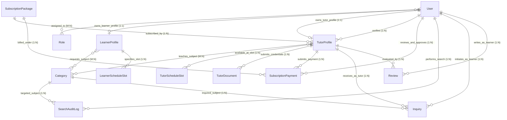

# TDMS — System Architecture: Class Diagram & Entity-Relationship Diagram (ERD)

This document provides the formal architectural diagrams and data specifications for the **Student-Tutor Discovery and Matching System (TDMS)**. It is structured into the following sections:

1. **Initial Domain Model (Conceptual ERD — Pure Entity Relations & Many-to-Many):** Pure conceptual model containing only core business entities and direct Many-to-Many ($M:N$) associations with **zero intersection / junction / dummy entities**.
2. **Detailed Physical ERD:** Full 3NF database schema with exact MariaDB physical data types and declared lengths (`varchar(150)`, `varchar(100)`, `varchar(36)`, `decimal(10,2)`, `longtext`, `datetime(6)`, etc.), physical junction tables, keys, and cascading actions.
3. **Domain Entities Class Diagram:** Object-oriented representation of domain models with properties and lifecycle/business methods.
4. **Architecture & Services Class Diagram:** System infrastructure, security handlers, deterministic matching engine, and messaging services with function signatures.
5. **Vertical Slice Endpoints Class Diagram:** Minimal API endpoint groups with HTTP handlers and authorization policies.
6. **Class Functional Responsibilities Directory:** Exhaustive reference explaining the purpose, business rules, and function of every class.

---

## 1. Initial Domain Model (Conceptual ERD — Entity Relations Only)

The **Initial Domain Model** represents the pure business entities and high-level domain concepts of TDMS. 

> [!IMPORTANT]
> **No Intersection / Dummy Entities:** In accordance with conceptual modeling standards, relational junction/dummy tables (such as `UserRoles`, `LearnerRequirementCategories`, and `TutorCategories`) are **omitted**. Instead, direct **Many-to-Many ($M:N$)** relationships are modeled directly between the participating business entities.

### 1.1 Conceptual Entity Relationships Diagram (Mermaid)



### 1.2 Conceptual Relationship Semantics & De-Junctioning Matrix

| Relationship | Type | Conceptual Semantic Meaning | Physical Relational Resolution in 3NF Schema |
| :--- | :---: | :--- | :--- |
| **`User` $\leftrightarrow$ `Role`** | **$M:N$** | A user can be assigned multiple security roles; a role belongs to multiple users. | Resolved via junction table **`UserRoles`** with composite PK `(UserId, RoleId)`. |
| **`LearnerProfile` $\leftrightarrow$ `Category`** | **$M:N$** | A parent or student can request tutoring across multiple subject categories; a category is requested by multiple learners. | Resolved via intersection table **`LearnerRequirementCategories`**. |
| **`TutorProfile` $\leftrightarrow$ `Category`** | **$M:N$** | A tutor can teach multiple subject categories; a category is offered by multiple tutors. | Resolved via intersection table **`TutorCategories`** (with grade target metadata). |
| **`User` $\rightarrow$ `LearnerProfile`** | **$1:0..1$** | A user owns at most one learner profile (`Parent` or `Student`). | 1:1 relation with unique foreign key `UserId`. |
| **`User` $\rightarrow$ `TutorProfile`** | **$1:0..1$** | A user registers at most one tutor profile. | 1:1 relation with unique foreign key `UserId`. |
| **`User` (Admin) $\rightarrow$ `TutorProfile`** | **$1:0..N$** | An operation admin reviews and approves/rejects tutor credentials. | Foreign key `VerifiedByUserId` (`SET NULL`). |
| **`User` (Admin) $\rightarrow$ `SubscriptionPayment`**| **$1:0..N$** | An operation admin verifies and confirms offline subscription payments. | Foreign key `ReviewedByUserId` (`SET NULL`). |
| **`SubscriptionPackage` $\rightarrow$ `TutorProfile`** | **$1:0..N$** | Tutors subscribe to an operational tier package (Free, Silver, Gold). | Foreign key `CurrentSubscriptionPackageId` (`SET NULL`). |
| **`TutorProfile` $\rightarrow$ `SubscriptionPayment`** | **$1:0..N$** | A tutor submits payment proofs (screenshots, transaction IDs) for paid tiers. | Foreign key `TutorProfileId` (`CASCADE`). |
| **`LearnerProfile` $\rightarrow$ `LearnerScheduleSlot`**| **$1:0..N$** | A learner defines recurring preferred lesson slots. | Foreign key `LearnerProfileId` (`CASCADE`). |
| **`TutorProfile` $\rightarrow$ `TutorScheduleSlot`** | **$1:0..N$** | A tutor declares weekly teaching availability windows. | Foreign key `TutorProfileId` (`CASCADE`). |
| **`TutorProfile` $\rightarrow$ `TutorDocument`** | **$1:0..N$** | A tutor uploads verification identity files and certificates. | Foreign key `TutorProfileId` (`CASCADE`). |
| **`User` / `TutorProfile` $\rightarrow$ `Inquiry`** | **$1:0..N$** | Direct handshake inquiry sent from a learner user to a tutor profile. | Foreign keys `LearnerUserId` and `TutorProfileId`. |
| **`User` / `TutorProfile` $\rightarrow$ `Review`** | **$1:0..N$** | A learner user writes a review evaluating a tutor profile (max 1 per pair). | Unique constraint on `(LearnerUserId, TutorProfileId)`. |

---

## 2. Detailed Physical ERD (Exact MariaDB Data Types & Declared Lengths)

The physical database is **MariaDB** managed via **EF Core 10**. In this physical ERD, all text and string attributes are declared with their **exact `varchar(length)`** definitions and specific relational column types (`varchar(150)`, `varchar(100)`, `varchar(36)`, `varchar(80)`, `varchar(50)`, `varchar(20)`, `varchar(500)`, `decimal(10,2)`, `longtext`, `datetime(6)`, etc.), matching the database DDL and EF Core configurations.

### 2.1 Physical ERD (Mermaid)

```mermaid
erDiagram
    %% ==========================================
    %% IAM & Access Control
    %% ==========================================
    Users ||--o{ UserRoles : "assigned_to (CASCADE)"
    Roles ||--o{ UserRoles : "has_role (CASCADE)"
    Roles ||--o{ RoleClaims : "grants (CASCADE)"

    %% ==========================================
    %% 1:1 Profiles
    %% ==========================================
    Users ||--o| LearnerProfiles : "owns_learner (CASCADE)"
    Users ||--o| TutorProfiles : "owns_tutor (CASCADE)"

    %% ==========================================
    %% Admin & Operational Audits
    %% ==========================================
    Users ||--o{ TutorProfiles : "verified_by (SET NULL)"
    Users ||--o{ SubscriptionPayments : "reviewed_by (SET NULL)"
    Users ||--o{ SearchAuditLogs : "searched_by (SET NULL)"

    %% ==========================================
    %% Learner Domain
    %% ==========================================
    LearnerProfiles ||--o{ LearnerRequirementCategories : "specifies (CASCADE)"
    Categories ||--o{ LearnerRequirementCategories : "tagged_in (RESTRICT)"
    LearnerProfiles ||--o{ LearnerScheduleSlots : "availability (CASCADE)"

    %% ==========================================
    %% Tutor Domain
    %% ==========================================
    TutorProfiles ||--o{ TutorDocuments : "submits (CASCADE)"
    TutorProfiles ||--o{ TutorCategories : "teaches (CASCADE)"
    Categories ||--o{ TutorCategories : "taught_by (RESTRICT)"
    TutorProfiles ||--o{ TutorScheduleSlots : "available_at (CASCADE)"

    %% ==========================================
    %% Subscription & Tier Domain
    %% ==========================================
    SubscriptionPackages ||--o{ TutorProfiles : "enrolled_in (SET NULL)"
    SubscriptionPackages ||--o{ SubscriptionPayments : "billed_under (RESTRICT)"
    TutorProfiles ||--o{ SubscriptionPayments : "submits_payment (CASCADE)"

    %% ==========================================
    %% Inquiry, Real-Time Messaging & Feedback
    %% ==========================================
    Users ||--o{ Inquiries : "initiated_by_learner (RESTRICT)"
    TutorProfiles ||--o{ Inquiries : "targeted_tutor (CASCADE)"
    Categories ||--o{ Inquiries : "inquiry_subject (RESTRICT)"

    Users ||--o{ Reviews : "authored_by_learner (RESTRICT)"
    TutorProfiles ||--o{ Reviews : "reviewed_tutor (CASCADE)"

    Categories ||--o{ SearchAuditLogs : "searched_subject (SET NULL)"

    %% ==========================================
    %% Exact Physical Column Declarations
    %% ==========================================
    Users {
        varchar(36) Id PK
        varchar(150) Email UK
        varchar(100) UserName UK
        varchar(150) FullName
        longtext PasswordHash
        varchar(50) PhoneNumber
        boolean IsActive
        datetime(6) CreatedAt
        datetime(6) UpdatedAt
    }

    Roles {
        varchar(36) Id PK
        varchar(80) Name UK
        varchar(255) Description
    }

    UserRoles {
        varchar(36) UserId PK_FK
        varchar(36) RoleId PK_FK
    }

    RoleClaims {
        int Id PK
        varchar(36) RoleId FK
        varchar(150) ClaimType
        varchar(50) ClaimValue
    }

    LearnerProfiles {
        varchar(36) Id PK
        varchar(36) UserId UK_FK
        varchar(20) AccountSubType
        varchar(50) GradeLevel
        decimal(10_2) PreferredMaxHourlyFee
        varchar(20) PreferredTeachingMode
        text LearningGoalsNote
        datetime(6) CreatedAt
        datetime(6) UpdatedAt
    }

    LearnerRequirementCategories {
        int Id PK
        varchar(36) LearnerProfileId FK
        int CategoryId FK
    }

    LearnerScheduleSlots {
        int Id PK
        varchar(36) LearnerProfileId FK
        tinyint DayOfWeek
        time StartTime
        time EndTime
    }

    Categories {
        int Id PK
        varchar(100) Name UK
        varchar(500) Description
        boolean IsActive
        datetime(6) CreatedAt
        datetime(6) UpdatedAt
    }

    SubscriptionPackages {
        int Id PK
        varchar(80) TierName UK
        int DurationDays
        decimal(10_2) DisplayFee
        int MaxActiveSubjects
        int PrioritySearchBoost
        longtext FeaturesJson
        boolean IsActive
        datetime(6) CreatedAt
        datetime(6) UpdatedAt
    }

    SubscriptionPayments {
        int Id PK
        varchar(36) TutorProfileId FK
        int SubscriptionPackageId FK
        decimal(18_2) Amount
        varchar(50) PaymentMethod
        varchar(20) TransactionLast6
        longtext ScreenshotUrl
        varchar(500) Notes
        varchar(30) Status
        varchar(500) RejectionReason
        varchar(36) ReviewedByUserId FK
        datetime(6) ReviewedAt
        datetime(6) CreatedAt
        datetime(6) UpdatedAt
    }

    TutorProfiles {
        varchar(36) Id PK
        varchar(36) UserId UK_FK
        varchar(150) Headline
        longtext Biography
        int YearsOfExperience
        decimal(10_2) HourlyFee
        varchar(20) TeachingMode
        longtext LayoutThemeJson
        longtext ProfilePictureUrl
        varchar(20) VerificationStatus
        varchar(500) RejectionReason
        varchar(36) VerifiedByUserId FK
        datetime(6) VerifiedAt
        int CurrentSubscriptionPackageId FK
        datetime(6) SubscriptionUpdatedAt
        decimal(3_2) AverageRating
        int TotalReviewsCount
        boolean IsPublished
        datetime(6) CreatedAt
        datetime(6) UpdatedAt
    }

    TutorDocuments {
        int Id PK
        varchar(36) TutorProfileId FK
        varchar(80) DocumentType
        varchar(255) FileName
        longtext FileUrl
        bigint FileSizeBytes
        datetime(6) UploadedAt
    }

    TutorCategories {
        int Id PK
        varchar(36) TutorProfileId FK
        int CategoryId FK
        varchar(50) GradeLevelTarget
    }

    TutorScheduleSlots {
        int Id PK
        varchar(36) TutorProfileId FK
        tinyint DayOfWeek
        time StartTime
        time EndTime
    }

    Inquiries {
        varchar(36) Id PK
        varchar(36) LearnerUserId FK
        varchar(36) TutorProfileId FK
        int CategoryId FK
        longtext InitialRequirementSummary
        varchar(20) Status
        varchar(128) FirebaseThreadId UK
        datetime(6) CreatedAt
        datetime(6) RespondedAt
        datetime(6) UpdatedAt
    }

    Reviews {
        varchar(36) Id PK
        varchar(36) LearnerUserId FK
        varchar(36) TutorProfileId FK
        int StarRating
        longtext Comment
        datetime(6) CreatedAt
        datetime(6) UpdatedAt
    }

    SearchAuditLogs {
        int Id PK
        int CategoryId FK
        varchar(36) LearnerUserId FK
        datetime(6) SearchedAt
    }

    SystemSettings {
        varchar(100) Key PK
        longtext ValueJson
        datetime(6) UpdatedAt
    }
```

### 2.2 Physical Schema Data Dictionary & Constraints Matrix

Below is the exhaustive relational definition for each table in MariaDB, including exact column data types, precision, declared lengths, constraints, and cascade actions.

#### A. Core IAM Subsystem
* **`Users`**
  * `Id`: `VARCHAR(36)` — Primary Key (GUID string).
  * `Email`: `VARCHAR(150)` — Not Null, Unique Index (`UK_Users_Email`).
  * `UserName`: `VARCHAR(100)` — Not Null, Unique Index (`UK_Users_UserName`).
  * `FullName`: `VARCHAR(150)` — Not Null.
  * `PasswordHash`: `LONGTEXT` — Not Null (BCrypt hash string).
  * `PhoneNumber`: `VARCHAR(50)` — Nullable.
  * `IsActive`: `BOOLEAN` — Not Null, Default `TRUE`.
  * `CreatedAt`: `DATETIME(6)` — Not Null.
  * `UpdatedAt`: `DATETIME(6)` — Nullable.

* **`Roles`**
  * `Id`: `VARCHAR(36)` — Primary Key (GUID string).
  * `Name`: `VARCHAR(80)` — Not Null, Unique Index (`UK_Roles_Name`).
  * `Description`: `VARCHAR(255)` — Nullable.

* **`UserRoles`** (Junction Table)
  * `UserId`: `VARCHAR(36)` — Primary Key (Composite), Foreign Key $\rightarrow$ `Users.Id` (`ON DELETE CASCADE`).
  * `RoleId`: `VARCHAR(36)` — Primary Key (Composite), Foreign Key $\rightarrow$ `Roles.Id` (`ON DELETE CASCADE`).

* **`RoleClaims`**
  * `Id`: `INT` — Primary Key (Auto-Increment).
  * `RoleId`: `VARCHAR(36)` — Not Null, Foreign Key $\rightarrow$ `Roles.Id` (`ON DELETE CASCADE`).
  * `ClaimType`: `VARCHAR(150)` — Not Null (Unique with `RoleId`: `UK_RoleClaims_RoleId_Type`).
  * `ClaimValue`: `VARCHAR(50)` — Not Null, Default `'true'`.

---

#### B. Learner Subsystem
* **`LearnerProfiles`**
  * `Id`: `VARCHAR(36)` — Primary Key (GUID string).
  * `UserId`: `VARCHAR(36)` — Not Null, Unique Index, Foreign Key $\rightarrow$ `Users.Id` (`ON DELETE CASCADE`).
  * `AccountSubType`: `VARCHAR(20)` — Not Null (`'Parent'` or `'Student'`).
  * `GradeLevel`: `VARCHAR(50)` — Nullable.
  * `PreferredMaxHourlyFee`: `DECIMAL(10,2)` — Not Null.
  * `PreferredTeachingMode`: `VARCHAR(20)` — Not Null (`'Online'`, `'InPerson'`, `'Both'`).
  * `LearningGoalsNote`: `TEXT` — Nullable.
  * `CreatedAt`: `DATETIME(6)` — Not Null.
  * `UpdatedAt`: `DATETIME(6)` — Nullable.

* **`LearnerRequirementCategories`** (Intersection Table)
  * `Id`: `INT` — Primary Key (Auto-Increment).
  * `LearnerProfileId`: `VARCHAR(36)` — Not Null, Foreign Key $\rightarrow$ `LearnerProfiles.Id` (`ON DELETE CASCADE`).
  * `CategoryId`: `INT` — Not Null, Foreign Key $\rightarrow$ `Categories.Id` (`ON DELETE RESTRICT`).

* **`LearnerScheduleSlots`**
  * `Id`: `INT` — Primary Key (Auto-Increment).
  * `LearnerProfileId`: `VARCHAR(36)` — Not Null, Foreign Key $\rightarrow$ `LearnerProfiles.Id` (`ON DELETE CASCADE`).
  * `DayOfWeek`: `TINYINT` — Not Null (`0` = Sunday .. `6` = Saturday).
  * `StartTime`: `TIME` — Not Null.
  * `EndTime`: `TIME` — Not Null.

---

#### C. Tutor Subsystem
* **`TutorProfiles`**
  * `Id`: `VARCHAR(36)` — Primary Key (GUID string).
  * `UserId`: `VARCHAR(36)` — Not Null, Unique Index, Foreign Key $\rightarrow$ `Users.Id` (`ON DELETE CASCADE`).
  * `Headline`: `VARCHAR(150)` — Nullable.
  * `Biography`: `LONGTEXT` — Nullable.
  * `YearsOfExperience`: `INT` — Not Null.
  * `HourlyFee`: `DECIMAL(10,2)` — Not Null.
  * `TeachingMode`: `VARCHAR(20)` — Not Null (`'Online'`, `'InPerson'`, `'Both'`).
  * `LayoutThemeJson`: `LONGTEXT` — Nullable (JSON profile theme configuration).
  * `ProfilePictureUrl`: `LONGTEXT` — Nullable (Base64 data URL).
  * `VerificationStatus`: `VARCHAR(20)` — Not Null (`'Pending'`, `'Verified'`, `'Rejected'`).
  * `RejectionReason`: `VARCHAR(500)` — Nullable.
  * `VerifiedByUserId`: `VARCHAR(36)` — Nullable, Foreign Key $\rightarrow$ `Users.Id` (`ON DELETE SET NULL`).
  * `VerifiedAt`: `DATETIME(6)` — Nullable.
  * `CurrentSubscriptionPackageId`: `INT` — Nullable, Foreign Key $\rightarrow$ `SubscriptionPackages.Id` (`ON DELETE SET NULL`).
  * `SubscriptionUpdatedAt`: `DATETIME(6)` — Nullable.
  * `AverageRating`: `DECIMAL(3,2)` — Not Null, Default `0.00`.
  * `TotalReviewsCount`: `INT` — Not Null, Default `0`.
  * `IsPublished`: `BOOLEAN` — Not Null, Default `FALSE`.
  * `CreatedAt`: `DATETIME(6)` — Not Null.
  * `UpdatedAt`: `DATETIME(6)` — Nullable.

* **`TutorDocuments`**
  * `Id`: `INT` — Primary Key (Auto-Increment).
  * `TutorProfileId`: `VARCHAR(36)` — Not Null, Foreign Key $\rightarrow$ `TutorProfiles.Id` (`ON DELETE CASCADE`).
  * `DocumentType`: `VARCHAR(80)` — Not Null (`'IdentityID'`, `'AcademicCertificate'`, `'TutoringProof'`, `'Other'`).
  * `FileName`: `VARCHAR(255)` — Nullable.
  * `FileUrl`: `LONGTEXT` — Not Null (Base64 data URL).
  * `FileSizeBytes`: `BIGINT` — Not Null, Default `0`.
  * `UploadedAt`: `DATETIME(6)` — Not Null.

* **`TutorCategories`** (Intersection Table)
  * `Id`: `INT` — Primary Key (Auto-Increment).
  * `TutorProfileId`: `VARCHAR(36)` — Not Null, Foreign Key $\rightarrow$ `TutorProfiles.Id` (`ON DELETE CASCADE`).
  * `CategoryId`: `INT` — Not Null, Foreign Key $\rightarrow$ `Categories.Id` (`ON DELETE RESTRICT`).
  * `GradeLevelTarget`: `VARCHAR(50)` — Nullable.

* **`TutorScheduleSlots`**
  * `Id`: `INT` — Primary Key (Auto-Increment).
  * `TutorProfileId`: `VARCHAR(36)` — Not Null, Foreign Key $\rightarrow$ `TutorProfiles.Id` (`ON DELETE CASCADE`).
  * `DayOfWeek`: `TINYINT` — Not Null (`0` = Sunday .. `6` = Saturday).
  * `StartTime`: `TIME` — Not Null.
  * `EndTime`: `TIME` — Not Null.

---

#### D. Catalog, Subscriptions & Payments
* **`Categories`**
  * `Id`: `INT` — Primary Key (Auto-Increment).
  * `Name`: `VARCHAR(100)` — Not Null, Unique Index (`UK_Categories_Name`).
  * `Description`: `VARCHAR(500)` — Nullable.
  * `IsActive`: `BOOLEAN` — Not Null, Default `TRUE`.
  * `CreatedAt`: `DATETIME(6)` — Not Null.
  * `UpdatedAt`: `DATETIME(6)` — Nullable.

* **`SubscriptionPackages`**
  * `Id`: `INT` — Primary Key (Auto-Increment).
  * `TierName`: `VARCHAR(80)` — Not Null, Unique Index (`UK_SubPackages_TierName`).
  * `DurationDays`: `INT` — Not Null.
  * `DisplayFee`: `DECIMAL(10,2)` — Not Null.
  * `MaxActiveSubjects`: `INT` — Not Null.
  * `PrioritySearchBoost`: `INT` — Not Null, Default `0`.
  * `FeaturesJson`: `LONGTEXT` — Nullable (JSON array).
  * `IsActive`: `BOOLEAN` — Not Null, Default `TRUE`.
  * `CreatedAt`: `DATETIME(6)` — Not Null.
  * `UpdatedAt`: `DATETIME(6)` — Nullable.

* **`SubscriptionPayments`**
  * `Id`: `INT` — Primary Key (Auto-Increment).
  * `TutorProfileId`: `VARCHAR(36)` — Not Null, Foreign Key $\rightarrow$ `TutorProfiles.Id` (`ON DELETE CASCADE`).
  * `SubscriptionPackageId`: `INT` — Not Null, Foreign Key $\rightarrow$ `SubscriptionPackages.Id` (`ON DELETE RESTRICT`).
  * `Amount`: `DECIMAL(18,2)` — Not Null.
  * `PaymentMethod`: `VARCHAR(50)` — Not Null (`'KBZPay'`, `'WavePay'`, `'AYAPay'`, `'CBPay'`, `'BankTransfer'`).
  * `TransactionLast6`: `VARCHAR(20)` — Not Null.
  * `ScreenshotUrl`: `LONGTEXT` — Not Null (Base64 data URL).
  * `Notes`: `VARCHAR(500)` — Nullable.
  * `Status`: `VARCHAR(30)` — Not Null, Default `'Pending'` (`'Pending'`, `'Confirmed'`, `'Rejected'`).
  * `RejectionReason`: `VARCHAR(500)` — Nullable.
  * `ReviewedByUserId`: `VARCHAR(36)` — Nullable, Foreign Key $\rightarrow$ `Users.Id` (`ON DELETE SET NULL`).
  * `ReviewedAt`: `DATETIME(6)` — Nullable.
  * `CreatedAt`: `DATETIME(6)` — Not Null.
  * `UpdatedAt`: `DATETIME(6)` — Nullable.

---

#### E. Communications, Reviews & Auditing
* **`Inquiries`**
  * `Id`: `VARCHAR(36)` — Primary Key (GUID string).
  * `LearnerUserId`: `VARCHAR(36)` — Not Null, Foreign Key $\rightarrow$ `Users.Id` (`ON DELETE RESTRICT`).
  * `TutorProfileId`: `VARCHAR(36)` — Not Null, Foreign Key $\rightarrow$ `TutorProfiles.Id` (`ON DELETE CASCADE`).
  * `CategoryId`: `INT` — Not Null, Foreign Key $\rightarrow$ `Categories.Id` (`ON DELETE RESTRICT`).
  * `InitialRequirementSummary`: `LONGTEXT` — Not Null.
  * `Status`: `VARCHAR(20)` — Not Null, Default `'Pending'` (`'Pending'`, `'Accepted'`, `'Declined'`).
  * `FirebaseThreadId`: `VARCHAR(128)` — Not Null, Unique Index (`UK_Inquiries_FirebaseThreadId`).
  * `CreatedAt`: `DATETIME(6)` — Not Null.
  * `RespondedAt`: `DATETIME(6)` — Nullable.
  * `UpdatedAt`: `DATETIME(6)` — Nullable.

* **`Reviews`**
  * `Id`: `VARCHAR(36)` — Primary Key (GUID string).
  * `LearnerUserId`: `VARCHAR(36)` — Not Null, Foreign Key $\rightarrow$ `Users.Id` (`ON DELETE RESTRICT`).
  * `TutorProfileId`: `VARCHAR(36)` — Not Null, Foreign Key $\rightarrow$ `TutorProfiles.Id` (`ON DELETE CASCADE`).
  * `StarRating`: `INT` — Not Null (Constrained `1` to `5`).
  * `Comment`: `LONGTEXT` — Not Null.
  * `CreatedAt`: `DATETIME(6)` — Not Null.
  * `UpdatedAt`: `DATETIME(6)` — Nullable.
  * *Constraint:* Unique Composite Index `(LearnerUserId, TutorProfileId)`.

* **`SearchAuditLogs`**
  * `Id`: `INT` — Primary Key (Auto-Increment).
  * `CategoryId`: `INT` — Nullable, Foreign Key $\rightarrow$ `Categories.Id` (`ON DELETE SET NULL`).
  * `LearnerUserId`: `VARCHAR(36)` — Nullable, Foreign Key $\rightarrow$ `Users.Id` (`ON DELETE SET NULL`).
  * `SearchedAt`: `DATETIME(6)` — Not Null.

* **`SystemSettings`**
  * `Key`: `VARCHAR(100)` — Primary Key.
  * `ValueJson`: `LONGTEXT` — Not Null (JSON payload).
  * `UpdatedAt`: `DATETIME(6)` — Not Null.

---

## 3. Domain Entities Class Diagram (With Methods & Functions)

This diagram shows all entity models defined in [src/TDMS.Api/Database/Entities](file:///home/chitswe/Projects/2026/TDMS/src/TDMS.Api/Database/Entities), including properties, domain functions, and invariants.


---

## 4. Architecture & Services Class Diagram (With Methods & Functions)

This diagram documents the core business services, persistence managers, PBAC security handlers, and external messaging services, detailing every public and protected member function.

```mermaid
classDiagram
    direction TB

    class AppDbContext {
        +DbSet~User~ Users
        +DbSet~Role~ Roles
        +DbSet~UserRole~ UserRoles
        +DbSet~RoleClaim~ RoleClaims
        +DbSet~LearnerProfile~ LearnerProfiles
        +DbSet~Category~ Categories
        +DbSet~SubscriptionPackage~ SubscriptionPackages
        +DbSet~SubscriptionPayment~ SubscriptionPayments
        +DbSet~TutorProfile~ TutorProfiles
        +DbSet~Inquiry~ Inquiries
        +DbSet~Review~ Reviews
        +DbSet~SearchAuditLog~ SearchAuditLogs
        +DbSet~SystemSetting~ SystemSettings
        +AppDbContext(DbContextOptions~AppDbContext~ options)
        #OnModelCreating(ModelBuilder modelBuilder) void
        +SaveChangesAsync(CancellationToken ct) Task~int~
        +SaveChanges() int
    }

    class AuditableEntityInterceptor {
        +SavingChanges(eventData, result) InterceptionResult~int~
        +SavingChangesAsync(eventData, result, ct) ValueTask~InterceptionResult~int~~
        -UpdateEntities(DbContext context)$ void
    }

    class DatabaseSeedService {
        +const string DefaultPassword
        -AppDbContext _context
        +DatabaseSeedService(AppDbContext context)
        +SeedAsync() Task
        -SeedRolesAndPermissionsAsync() Task
        -SeedDefaultAdminUserAsync() Task
        -SeedDefaultCategoriesAsync() Task
        -SeedDefaultSubscriptionPackagesAsync() Task
        -SeedDefaultSystemSettingsAsync() Task
        -SeedDefaultTutorsAsync() Task
        -SeedDefaultStudentsAsync() Task
        -SeedDefaultReviewsAsync() Task
        -SeedDefaultSubscriptionPaymentsAsync() Task
    }

    class ICurrentUser {
        <<interface>>
        +string? UserId
        +string? Email
        +IReadOnlyList~string~ Roles
        +bool IsAuthenticated
        +bool IsSystemAdmin
        +HasClaim(string claimType, string? claimValue) bool
    }

    class CurrentUser {
        -IHttpContextAccessor _httpContextAccessor
        -ClaimsPrincipal? User
        +CurrentUser(IHttpContextAccessor httpContextAccessor)
        +string? UserId
        +string? Email
        +IReadOnlyList~string~ Roles
        +bool IsAuthenticated
        +bool IsSystemAdmin
        +HasClaim(string claimType, string? claimValue) bool
    }

    class ITokenService {
        <<interface>>
        +GenerateTokenAsync(User user) Task~AuthResponse~
    }

    class TokenService {
        -AppDbContext _context
        -IConfiguration _configuration
        +TokenService(AppDbContext context, IConfiguration configuration)
        +GenerateTokenAsync(User user) Task~AuthResponse~
    }

    class AuthResponse {
        <<record>>
        +string Token
        +DateTime ExpiresAt
        +string UserId
        +string Email
        +string FullName
        +IReadOnlyList~string~ Roles
        +IReadOnlyDictionary~string, string~ Claims
        +string? AccountSubType
        +string? TutorVerificationStatus
    }

    class PermissionRequirement {
        +string Permission
        +PermissionRequirement(string permission)
    }

    class PermissionAuthorizationHandler {
        #HandleRequirementAsync(context, requirement) Task
    }

    class MatchingWeights {
        <<record>>
        +double W_subject
        +double W_fee
        +double W_schedule
        +double W_mode
        +MatchingWeights(double subject, double fee, double sched, double mode)
        +IsValid() bool
    }

    class LearnerScheduleCriteria {
        <<record>>
        +byte DayOfWeek
        +TimeSpan StartTime
        +TimeSpan EndTime
        +LearnerScheduleCriteria(byte day, TimeSpan start, TimeSpan end)
    }

    class LearnerMatchingCriteria {
        <<record>>
        +IReadOnlyList~int~ CategoryIds
        +decimal PreferredMaxHourlyFee
        +string PreferredTeachingMode
        +IReadOnlyList~LearnerScheduleCriteria~ PreferredSlots
    }

    class TutorCandidateInfo {
        <<record>>
        +string TutorProfileId
        +decimal HourlyFee
        +string TeachingMode
        +IReadOnlyList~int~ CategoryIds
        +IReadOnlyList~LearnerScheduleCriteria~ AvailableSlots
    }

    class MatchCalculationResult {
        <<record>>
        +double OverallPercentage
        +double SubjectScore
        +double FeeScore
        +double ScheduleScore
        +double ModeScore
    }

    class MatchingEngine {
        <<static>>
        +CalculateMatch(learner, tutor, weights)$ MatchCalculationResult
        +CalculateSlotOverlapRatio(requested, available)$ double
        +TimeRangesOverlap(start1, end1, start2, end2)$ bool
    }

    class MessageDto {
        <<record>>
        +string Id
        +string ThreadId
        +string SenderUserId
        +string SenderName
        +string Text
        +DateTime Timestamp
    }

    class IFirebaseMessagingService {
        <<interface>>
        +string ProviderName
        +InitializeThreadAsync(threadId, learnerUserId, tutorUserId, inquiryId, ct) Task
        +SendMessageAsync(threadId, senderUserId, senderName, text, ct) Task~MessageDto~
        +GetMessagesAsync(threadId, ct) Task~IReadOnlyList~MessageDto~~
    }

    class FirebaseRealtimeMessagingService {
        -HttpClient _httpClient
        -string _databaseUrl
        +FirebaseRealtimeMessagingService(HttpClient httpClient, IConfiguration config)
        +InitializeThreadAsync(threadId, learnerUserId, tutorUserId, inquiryId, ct) Task
        +SendMessageAsync(threadId, senderUserId, senderName, text, ct) Task~MessageDto~
        +GetMessagesAsync(threadId, ct) Task~IReadOnlyList~MessageDto~~
    }

    class MockFirebaseMessagingService {
        -ConcurrentDictionary _threads$
        -ConcurrentDictionary _messages$
        +MockFirebaseMessagingService()
        +InitializeThreadAsync(threadId, learnerUserId, tutorUserId, inquiryId, ct) Task
        +SendMessageAsync(threadId, senderUserId, senderName, text, ct) Task~MessageDto~
        +GetMessagesAsync(threadId, ct) Task~IReadOnlyList~MessageDto~~
    }

    ICurrentUser <|.. CurrentUser
    ITokenService <|.. TokenService
    IFirebaseMessagingService <|.. FirebaseRealtimeMessagingService
    IFirebaseMessagingService <|.. MockFirebaseMessagingService

    TokenService ..> AppDbContext : queries roles & claims
    TokenService ..> AuthResponse : creates JWT token
    DatabaseSeedService ..> AppDbContext : executes DDL & seeds
    AuditableEntityInterceptor ..> AppDbContext : intercepts SaveChanges

    MatchingEngine ..> MatchingWeights : verifies weights
    MatchingEngine ..> LearnerMatchingCriteria : reads learner criteria
    MatchingEngine ..> TutorCandidateInfo : scores candidate tutor
    MatchingEngine ..> MatchCalculationResult : computes output
```



---

## 5. Vertical Slice Endpoints Class Diagram (With Handlers & Policies)

Each slice in [src/TDMS.Api/Features](file:///home/chitswe/Projects/2026/TDMS/src/TDMS.Api/Features) exposes an extension method `Map*Endpoints` configuring route groups, request validation, dependencies, and authorization policies.


---

## 6. Class Functional Responsibilities & Methods Directory

This directory details the exact **business purpose (function)** and operational responsibilities of every class in the codebase.

### 6.1 Domain Entity Classes

| Class Name | Primary Function & Responsibility | Key Methods / Member Functions |
| :--- | :--- | :--- |
| **`User`** | Encapsulates the master authentication identity, password hash, user status, and root associations to profiles and roles. | `Activate()`, `Deactivate()`, `SetPasswordHash(hash)` |
| **`Role`** | Represents a system role (e.g., `ParentStudent`, `Tutor`, `OperationAdmin`, `SystemAdmin`) containing discrete permission claims. | `HasPermission(claimType)` |
| **`UserRole`** | Many-to-many junction entity binding a `User` to assigned `Role`s in the physical schema. | Constructor & relational navigation |
| **`RoleClaim`** | Represents a granular claim attached to a role (`{resource}:{action}` or `view:menu:*`). | `IsGranted()` |
| **`LearnerProfile`** | Manages parent or student learning preferences, target hourly budget, mode, and learning notes. | `IsParent()`, `IsStudent()`, `UpdatePreferences(subType, maxFee, mode)` |
| **`LearnerRequirementCategory`** | Associates requested subject categories with a learner's profile in the physical schema. | Entity relationship binding |
| **`LearnerScheduleSlot`** | Defines preferred weekly time windows for tutoring sessions. | `OverlapsWith(day, start, end)`, `GetDurationHours()` |
| **`TutorProfile`** | Manages tutor credentials, biography, pricing, verification status, rating aggregates, and publishing state. | `Verify(userId)`, `Reject(reason)`, `RequestReverification()`, `UpdateRating(avg, count)`, `Publish()`, `Unpublish()`, `AssignSubscription(packageId)` |
| **`TutorDocument`** | Stores uploaded proof of identity or academic certificates (base64 data URL). | `GetSizeInKb()` |
| **`TutorCategory`** | Maps a tutor to subjects they are qualified to teach along with target grade levels in the physical schema. | Entity relationship binding |
| **`TutorScheduleSlot`** | Defines a tutor's weekly recurring availability for lessons. | `OverlapsWith(day, start, end)`, `GetDurationHours()` |
| **`Category`** | Represents a system-wide subject classification (e.g. Mathematics, Physics, English). | `ToggleActive(isActive)` |
| **`SubscriptionPackage`** | Defines operational subscription tiers (duration, fee, subject limits, search priority boost). | `IsFreeTier()`, `GetParsedFeatures()` |
| **`SubscriptionPayment`** | Tracks manual mobile wallet payments submitted by tutors and operational review decisions. | `Confirm(reviewerUserId)`, `Reject(reason, reviewerUserId)`, `IsPending()` |
| **`Inquiry`** | Relational handshake connecting a learner and tutor prior to opening a chat thread. | `Accept(threadId)`, `Decline()`, `IsPending()` |
| **`Review`** | Stores 1-5 star ratings and narrative student feedback for tutors. | `UpdateCommentAndRating(stars, comment)` |
| **`SearchAuditLog`** | Captures anonymous or authenticated search queries for supply/demand reporting. | Constructor & audit logger |
| **`SystemSetting`** | Persistent key-value store for global platform parameters and algorithm weights. | `GetParsedValue<T>()`, `SetParsedValue<T>(value)` |

---

### 6.2 Core Business & Infrastructure Services

| Service / Class Name | Primary Function & Responsibility | Member Functions |
| :--- | :--- | :--- |
| **`MatchingEngine`** | Static calculation engine evaluating compatibility ($0\%–100\%$) between learner preferences and tutor candidate profiles. | `CalculateMatch(learner, tutor, weights)`<br>`CalculateSlotOverlapRatio(requested, available)`<br>`TimeRangesOverlap(start1, end1, start2, end2)` |
| **`MatchingWeights`** | Immutable configuration record holding the 4 weighting parameters ($W_{subject}=40\%$, $W_{fee}=25\%$, $W_{schedule}=25\%$, $W_{mode}=10\%$). | `IsValid()` (ensures weights sum to 100) |
| **`TokenService`** | JWT issuance service that resolves user roles, extracts role claims, deduplicates permissions, and emits signed bearer tokens. | `GenerateTokenAsync(User user)` |
| **`CurrentUser`** | Scoped accessor extracting user identity, roles, and claims from current `HttpContext`. Implements SystemAdmin automatic bypass. | `get_UserId()`, `get_Email()`, `get_Roles()`, `get_IsAuthenticated()`, `get_IsSystemAdmin()`, `HasClaim(type, value)` |
| **`PermissionAuthorizationHandler`** | ASP.NET Core authorization handler evaluating custom `PermissionRequirement`s against JWT claims with SystemAdmin role override. | `HandleRequirementAsync(context, requirement)` |
| **`AppDbContext`** | EF Core database context configuring entity mappings, cascades, unique indices, and precision rules. | `OnModelCreating(modelBuilder)`, `SaveChangesAsync(ct)`, `SaveChanges()` |
| **`AuditableEntityInterceptor`** | EF Core `SaveChangesInterceptor` automatically populating `CreatedAt` and `UpdatedAt` on `IAuditableEntity` models. | `SavingChanges(...)`, `SavingChangesAsync(...)`, `UpdateEntities(context)` |
| **`DatabaseSeedService`** | Database migrator and seeder ensuring required roles, SystemAdmin account, default categories, subscription tiers, and demo data exist. | `SeedAsync()`, `SeedRolesAndPermissionsAsync()`, `SeedDefaultAdminUserAsync()`, `SeedDefaultCategoriesAsync()`, `SeedDefaultTutorsAsync()`, etc. |
| **`FirebaseRealtimeMessagingService`** | External messaging client interacting with Firebase Realtime Database REST API (`/threads/{threadId}`). | `InitializeThreadAsync(...)`, `SendMessageAsync(...)`, `GetMessagesAsync(...)` |
| **`MockFirebaseMessagingService`** | In-memory concurrency-safe mock for offline development and fast unit testing. | `InitializeThreadAsync(...)`, `SendMessageAsync(...)`, `GetMessagesAsync(...)` |

---

### 6.3 Vertical Slice Endpoint Classes (Minimal APIs)

| Endpoint Group | Primary Function & Responsibility | Handled Endpoints & Operations |
| :--- | :--- | :--- |
| **`AuthEndpoints`** | Handles public user registration (Learner & Tutor) and credential validation. | `POST /api/auth/login`<br>`POST /api/auth/register/learner`<br>`POST /api/auth/register/tutor` |
| **`AccountEndpoints`** | Manages Parent/Student profile data, grade levels, and learning preferences (`learner_profiles:*`). | `GET /api/account/learner-profile`<br>`PUT /api/account/learner-profile` |
| **`TutorEndpoints`** | Multi-attribute search, profile inspection, teaching subjects, availability scheduling, and profile pictures. | `GET /api/tutors/search`<br>`GET /api/tutors/{id}`<br>`GET /api/tutors/me`<br>`PUT /api/tutors/me/teaching-info`<br>`PUT /api/tutors/me/customization`<br>`PUT /api/tutors/me/profile-picture`<br>`POST /api/tutors/me/documents`<br>`DELETE /api/tutors/me/documents/{id}`<br>`POST /api/tutors/me/reverify` |
| **`InquiryEndpoints`** | Governs relational contact handshakes between learners and tutors (`inquiries:*`). | `POST /api/inquiries`<br>`GET /api/inquiries`<br>`PUT /api/inquiries/{id}/respond` |
| **`MessagingEndpoints`** | Syncs text messages for accepted inquiry threads with Firebase (`messages:*`). | `POST /api/messages/{inquiryId}`<br>`GET /api/messages/{inquiryId}` |
| **`ReviewEndpoints`** | Collects student reviews and automatically triggers tutor average rating recalculation (`reviews:*`). | `GET /api/tutors/{tutorId}/reviews`<br>`POST /api/tutors/{tutorId}/reviews`<br>`PUT /api/reviews/{reviewId}`<br>`GET /api/reviews/me`<br>`RecalculateTutorRatingAsync(...)` |
| **`OperationEndpoints`** | Powers Operation Admin features: tutor verification, categories CRUD, subscription packages, and payment approvals (`operations:*`). | `GET /api/operations/tutors/pending`<br>`PUT /api/operations/tutors/{tutorId}/verify`<br>`GET/POST/PUT/DELETE /api/categories`<br>`GET/POST/PUT /api/subscriptions`<br>`POST /api/subscriptions/purchase`<br>`GET/PUT /api/operations/subscriptions/payments`<br>`GET /api/operations/reports` |
| **`AdminEndpoints`** | Executive system administration: user status, role/permission matrix, system telemetry, and DB integrity (`administration:*`). | `GET/PUT /api/admin/users`<br>`GET/POST/PUT /api/admin/roles`<br>`GET /api/admin/system-data`<br>`GET/PUT /api/admin/settings`<br>`POST /api/admin/database/maintenance` |
